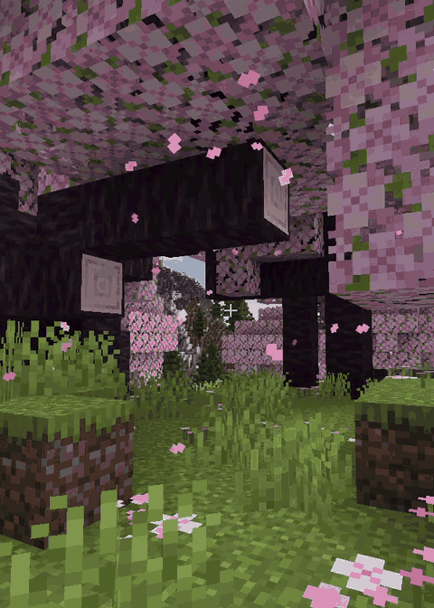

<p align="center"></p>

# Handy Toolbox

A Minecraft Forge 1.20.1 mod: a toolbox for crafting tools (GregTech files, hammers, saws, wrenches...).
When you click JEI's **[+]**, the tools a recipe needs are taken out of any toolbox in your inventory,
used in the craft and put back into the box when you close the crafting screen.

[CurseForge](https://www.curseforge.com/minecraft/mc-mods/handy-toolbox)



## Features

- 18-slot toolbox; keep it anywhere in your inventory or in your offhand.
- Works with JEI's [+] button (recipe transfer).
- Accepts GregTech CEu tools (including unbreakable ones) and any other single-stack tool with durability
  or a `forge:tools/...` tag.
- Tools keep their durability, enchantments and NBT. The server validates every move.

## For modpack makers

Replace the recipe `handytoolbox:toolbox` with KubeJS or a datapack:

```js
ServerEvents.recipes(event => {
  event.remove({ id: 'handytoolbox:toolbox' })
  event.shaped('handytoolbox:toolbox', [' S ', 'PCP', 'PPP'], {
    S: '#forge:rods/steel',
    P: '#forge:plates/steel',
    C: '#forge:chests/wooden'
  })
})
```

Allow more items in the box with the item tag `handytoolbox:storable`:

```js
ServerEvents.tags('item', event => {
  event.add('handytoolbox:storable', 'mymod:my_tool')
})
```

## Building

Requires JDK 17 or newer to run Gradle (the mod itself compiles with a Java 17 toolchain).

```
./gradlew build
```

The jar is written to `build/libs/`. `./gradlew runClient` starts a dev client with JEI.

## How it works

- `mixin/JeiRecipeTransferManagerMixin` wraps every recipe transfer handler JEI picks.
- `client/jei/ToolboxTransferHandler` checks whether the recipe only fails because of tools stored in a
  toolbox. If so, it lends them to the inventory (`ToolLending`), sends `BorrowToolsPacket` to the server and
  lets the original handler do the transfer.
- When a screen is closed, borrowed tools (marked in their NBT) go back into a toolbox.

Modpacks are welcome to include the mod.
